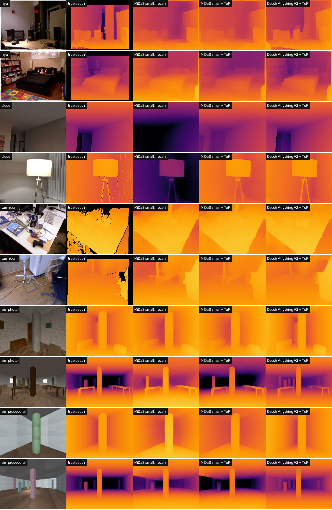

# VTOL indoor course sim

A keyboard-flyable drone in a procedurally generated room, built to prototype the
monocular obstacle-avoidance pipeline before any of it touches ROS 2, Gazebo, or hardware.

Runs natively on Apple Silicon. No Unity, no Docker, no virtual machine.

## Setup

Python 3.11 or newer.

    git clone https://github.com/JustSid26/drone-midas.git
    cd drone-midas
    python3 -m venv .venv
    .venv/bin/pip install -r requirements.txt

On Windows the interpreter is `.venv\Scripts\python` instead of `.venv/bin/python`
in every command below.

## Run

    .venv/bin/python fly.py --seed 0

    click map   add a station
    right-click remove the nearest station
    N           toggle auto navigation
    C           clear all stations
    arrows      forward / back / yaw left / yaw right (manual only)
    a  d        strafe
    r  f        climb / descend
    space       reset to start
    q or esc    quit

## Demo

Three short commands fly the same room and route on three depth sources, for
showing the result live:

    ./demo 1          perfect depth from the simulator (the target)
    ./demo 2          MiDaS, calibrated once (how the drone used it before)
    ./demo 3          MiDaS + 8x8 ToF sensor, re-fitted every frame
    ./demo rooms      the rooms tested for the demo, with expected results
    ./demo 2 116      any of them in another room

The default room is 103, an office: perfect depth and MiDaS + ToF both finish in
under 20 s without a contact, while MiDaS calibrated once bumps its way round in
almost two minutes. Each run places five waypoints and takes off by itself; space
replays the route, q quits. `./demo` wraps `fly.py --demo`, which fixes the route
and the time step so a live run repeats a headless one. Add `--record clip.mp4`
to any `fly.py` run to save a video.

## Room styles

    .venv/bin/python fly.py --seed 0 --style photo        default
    .venv/bin/python fly.py --seed 0 --style procedural   the original look
    .venv/bin/python fly.py --seed 0 --style flat         untextured

`photo` rooms use photographs of real surfaces (wood, carpet, tile, concrete, brick,
plaster, fabric, leather; CC0 from Poly Haven, in `textures/photo/`) at their true
size, in one of five themes: home, office, warehouse, loft and school. Each room gets
ceiling lights that cast shadows, plus a door, windows, pictures, sideboards, tables,
boxes and corner shelving.

That dressing is there for the camera, because real rooms are full of such things.
It never changes the course. The obstacles are identical in every style for a
given seed and collide as the same boxes and cylinders; the photographic surfaces
are drawn on separate meshes that nothing touches. Tall furniture stands only in
the corners, and everything else is either flush with a wall or lower than 0.8 m,
under the band the policy treats as flight level. With perfect depth the two
textured styles fly the same on seeds 100-149: 34/50 vs 34/50 collision-free at 4
obstacles, 24 vs 25 at 6, 12 vs 11 at 9, with contacts per course within about 10%.

Re-download the photographs with `.venv/bin/python textures.py --photo`.

## Auto navigation

Click stations on the map panel and press N. The aircraft flies them in order,
steering by depth alone and advancing when it comes within 0.7 m of each one.
Nothing about the route is planned in advance: the policy only ever reacts to
the frame in front of it plus a short-term memory of what has just left view.

The policy lives in `policy.py` and takes the depth map as an argument. That is
the seam for the ablation. Pass MuJoCo ground truth today, pass a MiDaS estimate
later, and the difference between the two runs on the same seeds is the result
the project is actually after.

Three layers, in priority order:

1. Safety stop. If anything at flight level is closer than 1.2 m in the forward
   wedge, forward motion is refused and the aircraft rotates on the spot. No
   learned component sits in this path.
2. Wing guard. The camera sees a wedge but the wingtip sweeps a full circle, so
   a coarse all-round memory of recent obstacles prevents rotating into
   something that has already left the frame. It is ego-motion compensated and
   decays; nothing is localised and no map is built.
3. Steering. Among headings wide enough for the wing at their own range, pick
   the one trading free depth against bearing to the station.

## Where it currently stands

Measured with perfect simulator depth, which is the ceiling. Seeds 100-149 were
never used while tuning, 4 stations per run, 10 m room, 100 degree lens.

    obstacles   route completed   collision-free   contacts/run   timeouts
            4          47/50           41/50           0.16           3
            6          38/50           33/50           0.20          12
            9          28/50           22/50           0.34          22

At 6 obstacles the 95% Wilson interval on collision-free completion is 52% to 78%.

Two things to read off this table.

Tuning the policy on 12 seeds gave 11/12, or 92%. The same parameters score 66%
on 50 seeds that were held out. That gap is overfitting to a small sample, and it
is the reason the project specification asks for separate tuning, validation and
frozen test splits. Quote the held-out number, never the tuned one.

Failures are overwhelmingly timeouts, not crashes. The safety layer is doing its
job at 0.2 contacts per run; what fails is the planner getting stuck in a concave
pocket with no representation in which "go around the far side" exists. That is a
property of a purely reactive method, not a bug, and belongs in the failure
analysis.

## Running with MiDaS

MiDaS-small estimates depth from the camera image alone, standing in for the
perfect simulator depth. The first run downloads the model, about 100 MB, into
`.torch/`, so it needs internet once. It runs on the Apple GPU (MPS), CUDA, or CPU,
whichever is available.

Fly on estimated depth instead of simulator truth:

    .venv/bin/python fly.py --seed 0 --midas

Controls are the same as above. The depth panel now shows the MiDaS estimate the
aircraft is actually flying on. MiDaS gives depth only up to an unknown scale and
offset, and `--align` chooses how those are found:

    frozen   fitted once against true depth, then never touched. The default,
             cached in .midas_calib.json per room style
    tof      refitted every frame against a simulated 8x8 zone time-of-flight
             sensor (VL53L5CX class: 45 degree field, 4 m range, 3% noise),
             hardware a real aircraft can carry. When the zones all see one
             surface and cannot fix both numbers, the offset from the last frame
             that could is kept
    oracle   refitted every frame against the full true depth: an upper bound,
             not something a real aircraft could do

Measure depth accuracy and speed on still frames, no flying:

    .venv/bin/python bench_midas.py

Prints AbsRel, RMSE and the delta < 1.25 accuracy for both alignments, plus
milliseconds per frame on your device.

Run the ablation, the result the project is after:

    .venv/bin/python ablation.py --seeds 100-129 --obstacles 6

Flies the same courses on perfect depth, on MiDaS with a frozen calibration, on
MiDaS refitted every frame against the 8x8 ToF sensor, and on no depth at all. It
prints route completion, collision-free runs with a 95% interval, contacts and
timeouts for each. `--model da2_small` swaps in Depth Anything V2, `--style` picks
the room style, and `--arms` picks which of perfect, frozen, tof, raw and none to
fly. MiDaS runs on every frame, so this is slow. Try `--seeds 100-104` first to
check it works.

## Does MiDaS work in real rooms?

Not the way the aircraft uses it today, and only marginally once that is fixed.

MiDaS-small reads the layout of a real room well. What fails is turning its output
into metres with one frozen calibration: the scale changes from frame to frame and
from room to room. A cheap range sensor fixes the scale, but MiDaS-small still reports
the nearest obstacle about 12% farther away than it is. Even then it calls the way
clear for roughly 1 in 6 obstacles inside 1 m. Depth Anything V2 Small, a network of
the same size run the same way, misses 1 in 16 on real images and has almost no
bias. In simulated flight, though, the two networks tie, so the case for switching
rests on the real images until it is checked on the aircraft's own camera.

### What was tested

    data             frames  depth from                    why
    NYU Depth V2        654  Kinect, homes and offices     the standard benchmark, official test split
    DIODE indoor        252  laser scanner                 accurate; calibrated in a hall, tested in offices
    TUM fr1/room        386  Kinect, handheld video        moving through a cluttered office
    TUM fr2/pioneer     238  Kinect on a wheeled robot     a moving platform in a large hall
    sim, photo          180  MuJoCo                        the new room style
    sim, procedural     180  MuJoCo                        the original room style

Every estimator runs on every frame. Its output is turned into metres four ways:
frozen, tof and oracle as in `--align` above, plus raw for the metric network.
Two kinds of score come out:

- **AbsRel**, the mean relative error, which compares directly with published results.
  On NYU, MiDaS-small with oracle alignment scores 0.121.
- **Flight decisions.** These come from running the policy's own depth processing
  (`policy.py`) on the truth and on the estimate:
  - **False stop:** the way is clear, but the estimate says stop.
  - **Missed:** something is truly inside 1.0 m, but the estimate says the way is
    clear past 1.2 m.
  - **Near obstacle reads:** the estimated distance of the nearest obstacle divided
    by the true one.

### Real rooms, 1,530 frames pooled

    MiDaS-small, as the aircraft uses it   AbsRel        false stop   missed   near obstacle reads
    frozen calibration                     0.16 - 1.72     18.6%      32.5%    12% too far
    + 8x8 ToF, refit every frame           0.10 - 0.13      0.8%      18.5%    12% too far
    perfect alignment (oracle)             0.07 - 0.12      0.7%      15.3%    11% too far

    other networks, + 8x8 ToF
    MiDaS DPT-Hybrid (6x larger)           0.07 - 0.11      1.5%      12.8%    10% too far
    Depth Anything V2 small                0.05 - 0.07      3.6%       6.1%     2% too far
    Depth Anything V2 small, metric        0.06 - 0.09      3.3%       8.4%     3% too far
      the same, raw metres, no sensor      0.18 - 0.30     16.6%      35.8%    30% too far

AbsRel is the range across the four real datasets.

### Closed loop, photo rooms, seeds 100-129, 6 obstacles

    depth source                        complete  collision-free  95% CI   contacts/run  timeouts
    perfect depth                         29/30        16/30      36-70 %      1.90          1
    MiDaS-small, frozen (today)           19/30         8/30      14-44 %      2.43         11
    MiDaS-small + 8x8 ToF                 28/30        11/30      22-54 %      3.03          2
    Depth Anything V2 small, frozen       15/30         8/30      14-44 %      3.07         15
    Depth Anything V2 small + 8x8 ToF     27/30        12/30      25-58 %      3.33          3
    no depth                              16/30         6/30      10-37 %     74.40         14

The same 30 courses for every row, 4 stations each. Perfect depth is the ceiling:
the policy itself still touches things about twice a course.

These flights were measured before photo-room collisions were switched from the
textured meshes to plain boxes and cylinders, and have not been re-run since. With
perfect depth the switch left the 50-course results unchanged within noise, so the
comparison should hold, but re-run the two `ablation.py` commands below to refresh it.

### What it means

1. **The frozen calibration is the main failure.** MiDaS returns inverse depth with
   an unknown scale and offset, and both drift. In the TUM room video, the
   calibration from its first seconds produces false stops on 81% of later frames
   where the way was clear. On DIODE it was calibrated in a hall (median depth 8 m)
   and tested in offices (2 m): it reads every office about 4 times too far and
   misses every close obstacle. In the simulator it shows up as 11 timeouts in 30
   courses.
2. **A range sensor fixes the scale.** Refitting every frame against an 8x8 zone
   ToF sensor (VL53L5CX class, 4 m range) cuts false stops from 19% to under 1% and
   halves AbsRel. In closed loop it brings route completion back to the
   perfect-depth level.
3. **What remains is the network.** Even perfectly aligned, MiDaS-small reads the
   nearest obstacle about 11% too far, so a 1.2 m trip point really trips near
   1.05 m. In the simulator that is the rise in contacts from 1.9 to 3.0 per course
   with ToF. On real images, Depth Anything V2 Small aligned the same way cuts misses
   to 6% and the bias to 2%.
4. **In simulated flight that advantage does not show.** With ToF the two networks
   finish and collide alike (28 vs 27 routes, 3.0 vs 3.3 contacts per course). The
   rendered rooms are still not real photographs, and at 30 courses only large
   differences show. Depth Anything also proved more sensitive to the sensor
   fallback. When one wall fills the view, the zones cannot fix both numbers, so one
   has to be carried over from somewhere. Carrying over the offset from calibration
   made it false-stop on 57% of those frames and time out on half of the hard
   courses. Carrying over the last full fit, which `--align tof` now does, fixed that.
5. **A metric network does not remove the sensor.** Depth Anything's metric indoor
   model, used in raw metres, misses 36% on real rooms. In the simulator it is off
   by more than 100%, because its sense of scale is tied to the roughly 60 degree
   cameras it was trained on, and the aircraft has a 100 degree lens.

### Recommendation

- Do not fly on MiDaS with a frozen calibration.
- Mount an 8x8 ToF sensor on the nose, looking where the camera looks, and refit
  scale and offset every frame (`--align tof`).
- Lean towards Depth Anything V2 Small, but confirm it first on footage from the
  aircraft's camera. It wins clearly on real images and ties in simulated flight. It
  is in `estimators.py`, and `ablation.py --model da2_small` flies it. On the M5 GPU
  it takes 39 ms a frame against 13 ms for MiDaS-small, so 26 against 79 frames per
  second. On four CPU threads it measured 126 ms against 170 ms.
- Put direct range back into the safety stop. The design above promises no learned
  component in that path, but flying on MiDaS puts one there. Driving the stop
  layer from the ToF zones directly would restore that. This has not been tested here.
- Record a few minutes from the real camera before trusting simulator numbers. The
  datasets are about 60 degree cameras, and the aircraft's lens is 100 degrees.

### Limits

- The ToF sensor is simulated from true depth with 3% noise and covers only the
  central 45 degrees. Real ones also struggle with glass, black surfaces and sunlight.
- Glass, mirrors, low light and motion blur at flight speed are barely covered.
- Missed-stop rates come from handheld and robot views scored through the
  policy's flight band. They rank estimators fairly but are not crash rates.
- Even photo rooms are harder for MiDaS than real ones: oracle AbsRel is 0.14 in
  the simulator against 0.07 to 0.12 on real data. Part of the gap is the 100 degree
  lens. Closed-loop numbers for MiDaS are therefore likely pessimistic.

### Reproduce

    .venv/bin/python indoor_data.py --download   # about 5.5 GB into data/
    .venv/bin/python eval_real.py                # every model on every dataset, cached in data/results
    .venv/bin/python eval_real.py --summary      # pooled table, data/results/summary.json
    .venv/bin/python eval_real.py --figures      # the example frames above
    .venv/bin/python eval_real.py --speed        # ms per frame at the sim camera size
    .venv/bin/python ablation.py --seeds 100-129 --obstacles 6
    .venv/bin/python ablation.py --seeds 100-129 --obstacles 6 --model da2_small --arms frozen,tof

The Depth Anything models download from Hugging Face on first use, about 100 MB each.

## Headless evaluation

    .venv/bin/python run_route.py --seeds 0-49 --stations 4

Scores every seed for stations reached, contact events, and time. This is the
harness the graded numbers come from.

Three panels: chase view on the left, the aircraft's camera top right, and perfect
ground-truth depth below it. The depth panel is what the MiDaS estimate will be
scored against later.

Other seeds give different courses. `--obstacles` and `--room` change the difficulty.

    .venv/bin/python fly.py --seed 12 --obstacles 14 --room 12

## The aircraft

The flying model is the team's own airframe, tessellated from
`09_vtol_shell_combined_aero.step` into `meshes/vtol_shell.stl` and recentred so
the body origin sits at the planform centre with the nose toward +x. The camera
is mounted just ahead of the nose.

The shell is visual only. Collision uses a box matching the measured envelope,
0.815 by 1.000 by 0.231 m, which keeps contacts cheap and makes the wingspan
exactly what the course was designed around. Run with `--show-hull` to see it.

Regenerate the mesh after any CAD change:

    .venv/bin/python convert_cad.py <folder-with-step-files>

## Why the room is 10 m

The airframe measures 1.00 m across the wing, taken from the team's STEP files.
Obstacles sit on a 2.5 m grid with bounded jitter, so the narrowest gap is 1.40 m,
leaving 0.40 m of clearance. Shrink the room and the course stops being flyable
rather than becoming harder.

## Flight model

Motion is kinematic with collision rejection. A move that would intersect geometry
is refused and counted. That keeps the aircraft controllable by hand and makes the
collision count exact, which is the metric the graded project reports. Real
dynamics, rotor thrust, and hover-to-cruise transition come later from PX4 SITL.

## Files

    room.py                seeded course generator, emits MJCF
    fly.py                 interactive sim, map panel, manual and auto flight
    policy.py              reactive avoidance policy and safety layers
    run_route.py           headless batch scoring over many seeds
    midas_depth.py         MiDaS-small wrapper, scale and offset alignment, metrics
    bench_midas.py         MiDaS depth accuracy and speed on sim frames
    ablation.py            perfect vs MiDaS vs no depth on identical courses
    indoor_data.py         NYU Depth V2, DIODE and TUM RGB-D loaders and download
    estimators.py          MiDaS and Depth Anything V2 behind one interface
    eval_real.py           every estimator on real rooms and sim frames, same scoring
    textures.py            procedural textures, and the Poly Haven photo fetcher
    textures/photo/        photographic surfaces for the photo room style (CC0)
    convert_cad.py         STEP to STL for the team's airframe parts
    cad/                   the team's STEP parts, copied out of WhatsApp temp
    meshes/vtol_shell.stl  the flying model

## Next

1. Tune the policy parameters with Optuna against `run_route`, which is what the
   coursework asks for. The parameters are already constructor arguments.
2. Log every run to MLflow: seed, contacts, time, minimum clearance.
3. Move to PX4 SITL for real flight dynamics and the hover-to-cruise transition.
